# LifeDays — контейнеризація та локальне розгортання вебзастосунку з використанням Docker

Лабораторна робота з дисципліни DevOps і хмарні обчислення

| | |
|---|---|
| Виконав | студент 4 курсу групи 545б Подолянчик Ярослав Олегович |
| Прийняв | к. т. н., доцент каф. 503 Узун Дмитро Дмитрович |
| Заклад | Національний аерокосмічний університет «Харківський авіаційний інститут», 2026 |

## Зміст

- [Мета](#мета)
- [Постановка задачі](#постановка-задачі)
- [Структура репозиторію](#структура-репозиторію)
- [Швидкий запуск](#швидкий-запуск)
- [Хід роботи](#хід-роботи)
  - [1. Підготовка віртуальної машини](#1-підготовка-віртуальної-машини)
  - [2. Встановлення Docker Engine](#2-встановлення-docker-engine)
  - [3. Проєкт LifeDays і Dockerfile](#3-проєкт-lifedays-і-dockerfile)
  - [4. Збирання образу та запуск версії 1.0](#4-збирання-образу-та-запуск-версії-10)
  - [5. Керування життєвим циклом контейнера](#5-керування-життєвим-циклом-контейнера)
  - [6. Оновлення застосунку до версії 1.1](#6-оновлення-застосунку-до-версії-11)
- [Відповіді на контрольні запитання](#відповіді-на-контрольні-запитання)
- [Висновки](#висновки)

## Мета

Ознайомитися з основами контейнеризації за допомогою Docker, навчитися створювати Dockerfile, збирати Docker-образ вебзастосунку, запускати контейнер із відображенням мережевих портів, керувати життєвим циклом контейнера та виконувати ручне оновлення застосунку до нової версії.

## Постановка задачі

За методичними вказівками «Контейнеризація та локальне розгортання вебзастосунку з використанням Docker» підготувати віртуальну машину з Ubuntu Server 24.04 LTS у VirtualBox, встановити Docker Engine, створити образ вебзастосунку LifeDays (Python 3.12, Flask, Gunicorn), запустити його в контейнері з доступом із браузера фізичного комп'ютера, виконати основні операції керування контейнером і розгорнути нову версію застосунку. Звіт оформити у вигляді скріншотів покрокової реалізації завдання.

## Структура репозиторію

```
.
├── Dockerfile              # опис образу
├── .dockerignore
├── VERSION                 # версія застосунку (1.1.0)
├── app.py                  # Flask-застосунок: сторінка / та endpoint /health
├── calculator.py           # розрахунок кількості прожитих днів
├── requirements.txt        # Flask, Gunicorn
├── requirements-dev.txt    # pytest
├── templates/index.html    # HTML-шаблон
├── static/style.css        # стилі
├── tests/                  # тести pytest
└── docs/screenshots/       # скріншоти виконання роботи
```

## Швидкий запуск

У каталозі репозиторію на ВМ з Docker:

```bash
sudo docker build -t lifedays:1.1 .
sudo docker run -d --name lifedays -p 192.168.56.101:8080:8000 lifedays:1.1
curl http://192.168.56.101:8080/health      # {"status":"ok","version":"1.1.0"}
```

Застосунок: http://192.168.56.101:8080

## Хід роботи

### 1. Підготовка віртуальної машини

Для виконання роботи у VirtualBox підготовлено віртуальну машину Docker-LifeDays з Ubuntu Server 24.04.4 LTS: 2 vCPU, 3 ГБ оперативної пам'яті, віртуальний диск 25 ГБ, мережевий адаптер 1 – NAT для доступу до мережі Інтернет, адаптер 2 – Host-only для зв'язку з фізичним комп'ютером.

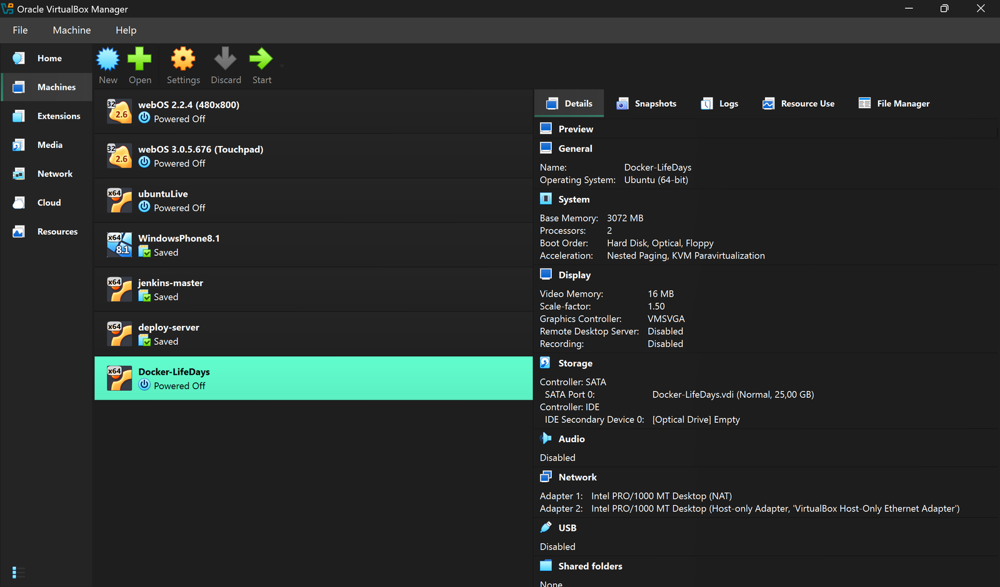

*Рис. 1 – Параметри віртуальної машини Docker-LifeDays у VirtualBox*

Для мережі Host-only на хост-системі задано адресу 192.168.56.1 з маскою 255.255.255.0. Через цей інтерфейс фізичний комп'ютер підключається до віртуальної машини по SSH і відкриває вебзастосунок у браузері.

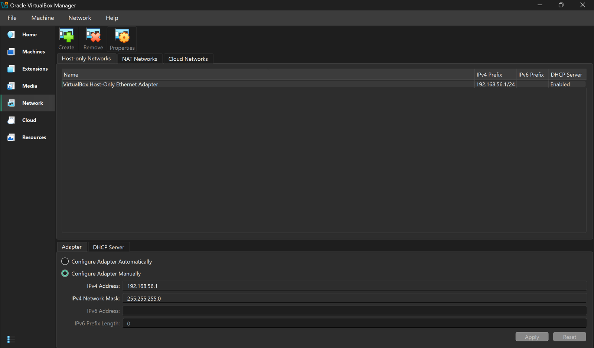

*Рис. 2 – Налаштування мережі Host-only у VirtualBox*

Ім'я хоста docker-lifedays, а для другого мережевого інтерфейсу enp0s8 створено файл конфігурації netplan /etc/netplan/60-hostonly.yaml зі статичною адресою 192.168.56.101/24. Після застосування конфігурації інтерфейс отримав адресу, служба SSH активна, а хост-система 192.168.56.1 відповідає на ping.

```bash
sudo hostnamectl set-hostname docker-lifedays
sudo nano /etc/netplan/60-hostonly.yaml
sudo chmod 600 /etc/netplan/60-hostonly.yaml
sudo netplan apply
ip -br a
```

```yaml
network:
  version: 2
  ethernets:
    enp0s8:
      dhcp4: false
      addresses: [192.168.56.101/24]
```

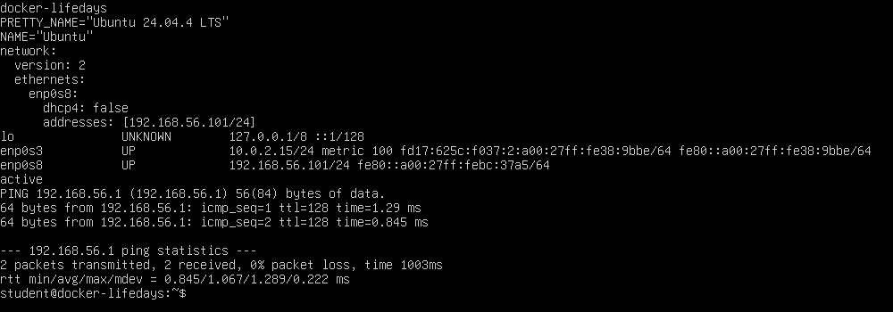

*Рис. 3 – Ім'я хоста, конфігурація netplan і мережеві інтерфейси віртуальної машини*

Подальша робота виконувалася через SSH-клієнт MobaXterm. Створено сесію Docker-LifeDays з параметрами: протокол SSH, віддалений хост 192.168.56.101, користувач student, порт 22.

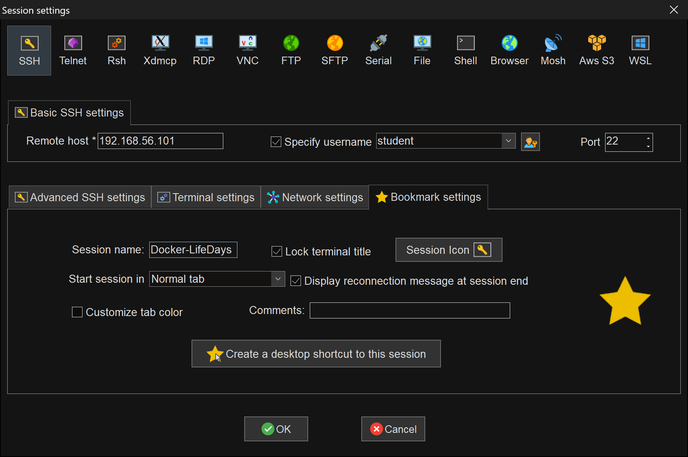

*Рис. 4 – Налаштування SSH-сесії в MobaXterm*

Після введення пароля встановлено SSH-з'єднання з віртуальною машиною: команди виконуються від користувача student на хості docker-lifedays, інтерфейс enp0s8 має адресу 192.168.56.101.

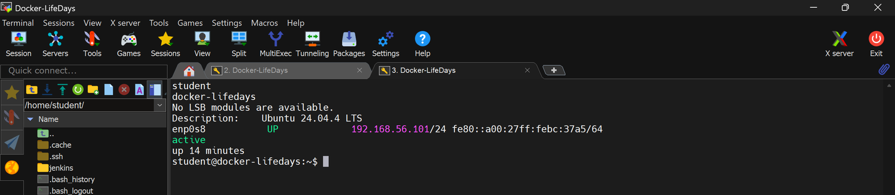

*Рис. 5 – Підключення до віртуальної машини через MobaXterm*

### 2. Встановлення Docker Engine

Встановлення Docker, sudo apt update та sudo apt install -y docker.io. Разом із пакетом docker.io встановлено середовище виконання containerd і runc, а також створено системну групу docker.

```bash
sudo apt update
sudo apt install -y docker.io
```

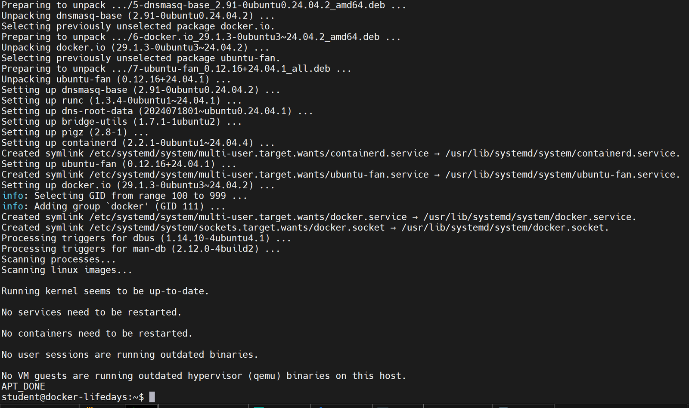

*Рис. 6 – Встановлення пакета docker.io*

Службу Docker запущено й додано до автозапуску командою sudo systemctl enable --now docker. Команда sudo docker version показує клієнт і сервер Docker.

```bash
sudo systemctl enable --now docker
sudo docker version
```

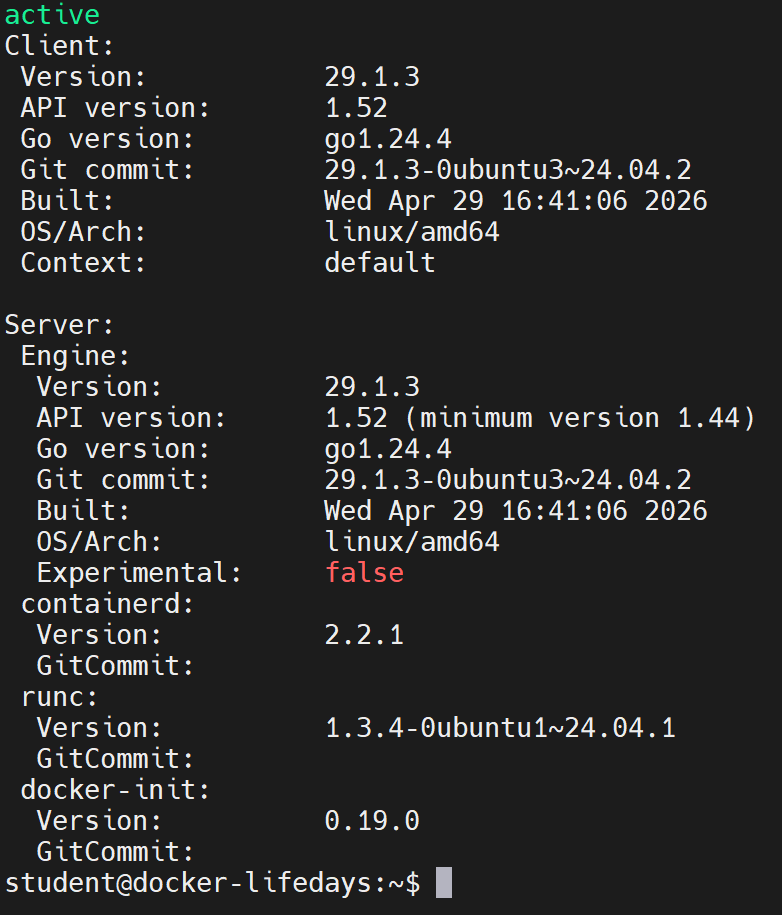

*Рис. 7 – Запуск служби Docker і результат команди docker version*

Команда sudo docker info виводить загальну інформацію про середовище Docker: використання cgroups версії 2, драйвери мережі та журналювання, кількість процесорів, обсяг пам'яті, ім'я вузла та каталог даних.

```bash
sudo docker info
```

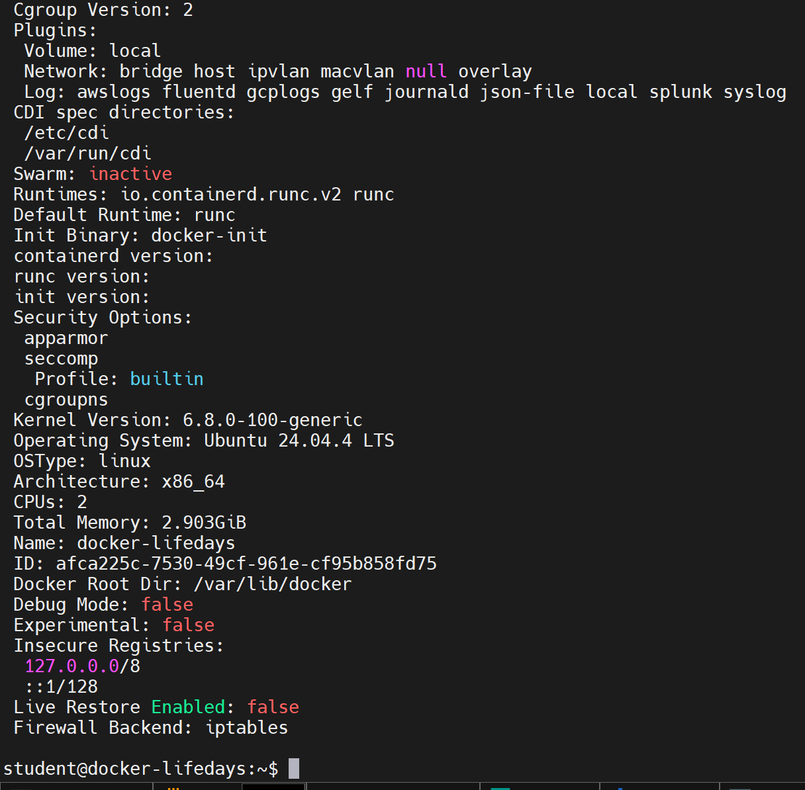

*Рис. 8 – Результат команди docker info*

Працездатність Docker перевірено тестовим контейнером. sudo docker run --rm hello-world завантажила образ hello-world з Docker Hub, створила з нього контейнер і вивела повідомлення.

```bash
sudo docker run --rm hello-world
```

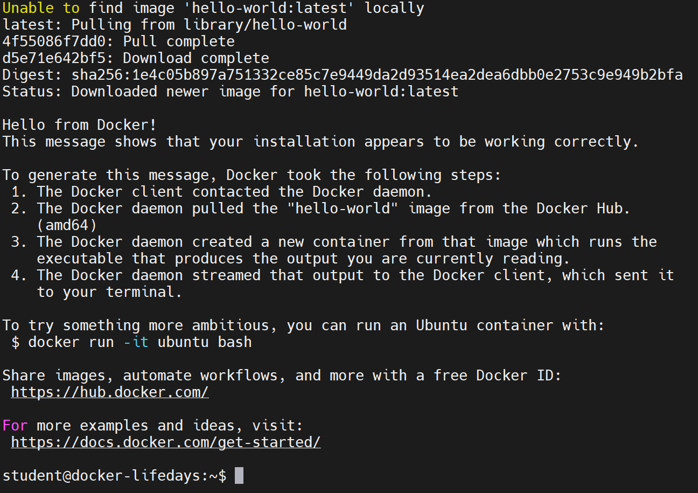

*Рис. 9 – Перевірка Docker тестовим контейнером hello-world*

### 3. Проєкт LifeDays і Dockerfile

Архів проєкту перенесено у віртуальну машину та розпаковано в домашній каталог. Dockerfile використовує базовий образ, встановлює залежності Flask і Gunicorn, копіює код до каталогу /app, створює непривілейованого користувача, оголошує порт 8000.

```dockerfile
FROM python:3.12-slim
WORKDIR /app
ENV PYTHONDONTWRITEBYTECODE=1 PYTHONUNBUFFERED=1 TZ=Europe/Kyiv
RUN groupadd --system web && useradd --system --gid web web
COPY requirements.txt .
RUN pip install --no-cache-dir -r requirements.txt
COPY app.py calculator.py VERSION ./
COPY templates/ templates/
COPY static/ static/
USER web
EXPOSE 8000
HEALTHCHECK --interval=30s --timeout=3s --start-period=5s CMD ["python", "-c", "import urllib.request; urllib.request.urlopen('http://127.0.0.1:8000/health', timeout=2)"]
CMD ["gunicorn", "--bind", "0.0.0.0:8000", "--workers", "2", "app:app"]
```

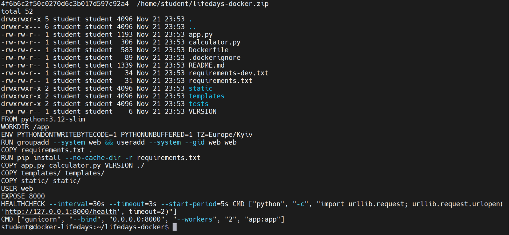

*Рис. 10 – Файли проєкту LifeDays і вміст Dockerfile*

### 4. Збирання образу та запуск версії 1.0

```bash
sudo docker build -t lifedays:1.0 .
```

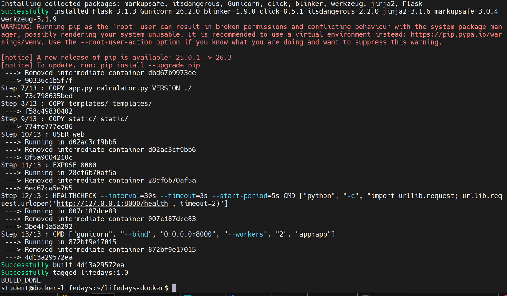

*Рис. 11 – Збирання образу lifedays:1.0*

sudo docker images показує створений образ lifedays, базовий образ python та тестовий образ hello-world.

```bash
sudo docker images
```

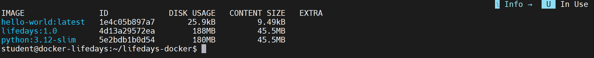

*Рис. 12 – Перелік Docker-образів*

Контейнер запущено у фоновому режимі командою sudo docker run -d --name lifedays -p 192.168.56.101:8080:8000 lifedays:1.0. Порт 8080 Host-only інтерфейсу віртуальної машини відображено на порт 8000 застосунку в контейнері. Команда sudo docker ps показує контейнер у стані Up з позначкою healthy, тобто перевірка HEALTHCHECK пройшла успішно.

```bash
sudo docker run -d --name lifedays -p 192.168.56.101:8080:8000 lifedays:1.0
sudo docker ps
```

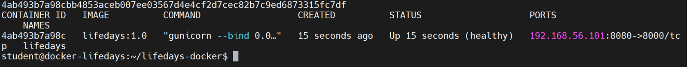

*Рис. 13 – Запуск контейнера lifedays і перелік активних контейнерів*

Журнал контейнера показує запуск Gunicorn з двома робочими процесами

```bash
sudo docker logs lifedays
curl http://192.168.56.101:8080/health
```

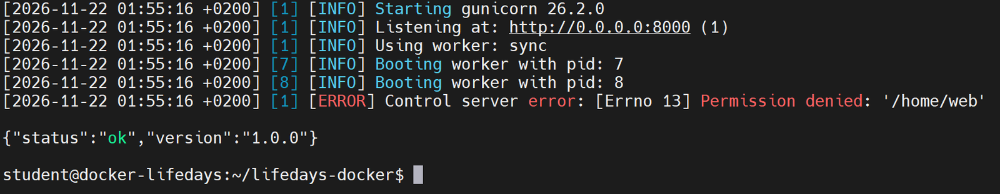

*Рис. 14 – Журнал контейнера та перевірка службового endpoint /health*

Застосунку за адресою http://192.168.56.101:8080

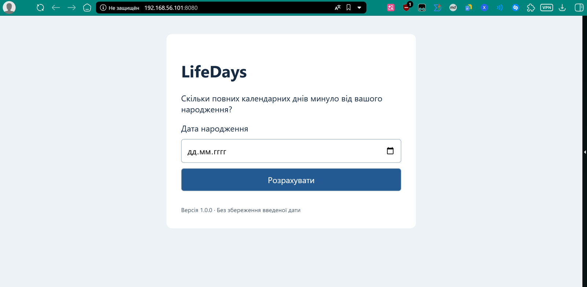

*Рис. 15 – Вебінтерфейс LifeDays версії 1.0.0 у браузері фізичного комп'ютера*

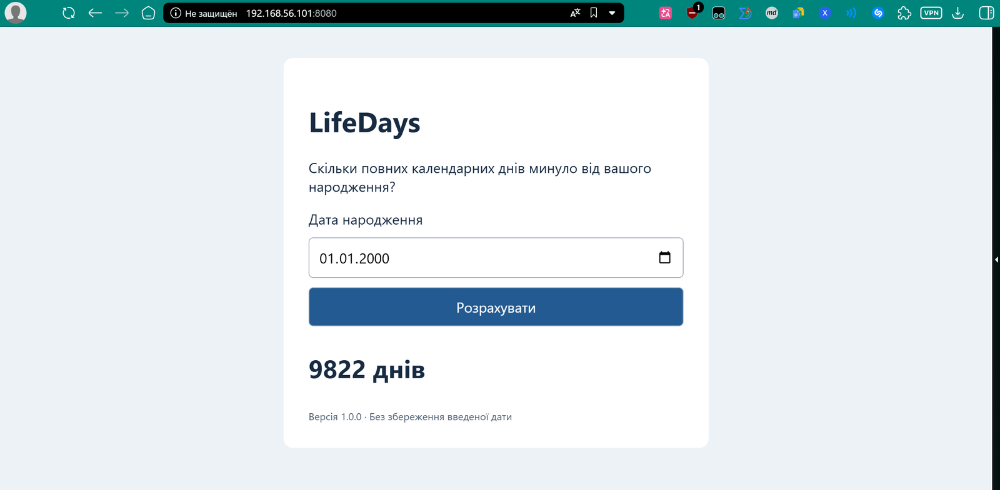

*Рис. 16 – Результат розрахунку прожитих днів*

### 5. Керування життєвим циклом контейнера

Перевірка керування життєвим циклом контейнера

```bash
sudo docker stop lifedays
sudo docker ps
sudo docker ps -a
```

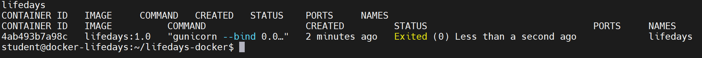

*Рис. 17 – Зупинення контейнера та перегляд усіх контейнерів*

sudo docker start lifedays запускає збережений контейнер, sudo docker restart lifedays перезапускає його.

```bash
sudo docker start lifedays
sudo docker restart lifedays
sudo docker ps
```

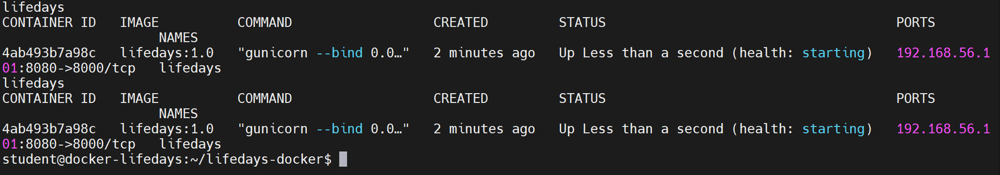

*Рис. 18 – Запуск зупиненого контейнера та перезапуск*

sudo docker stats --no-stream lifedays показує споживання ресурсів контейнером

```bash
sudo docker stats --no-stream lifedays
```

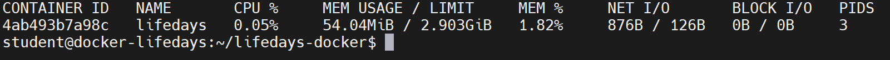

*Рис. 19 – Перегляд ресурсів контейнера*

sudo docker exec -it lifedays sh відкриває інтерактивну оболонку всередині запущеного контейнера. Застосунок працює від користувача web, робочий каталог – /app, файли застосунку належать користувачу root.

```bash
sudo docker exec -it lifedays sh
whoami
pwd
ls -la
python --version
exit
```

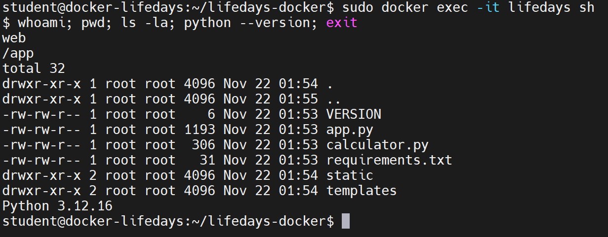

*Рис. 20 – Вхід до контейнера командою docker exec*

sudo docker inspect lifedays виводить повну конфігурацію контейнера у форматі JSON. За допомогою параметра --format отримано основні відомості

```bash
sudo docker inspect --format 'Image={{.Config.Image}} Status={{.State.Status}} Health={{.State.Health.Status}} User={{.Config.User}}' lifedays
sudo docker inspect lifedays
```

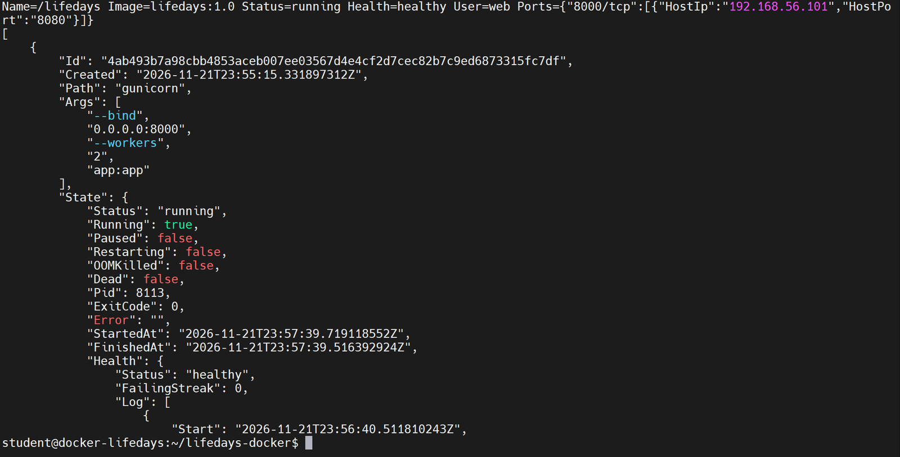

*Рис. 21 – Перегляд конфігурації контейнера командою docker inspect*

### 6. Оновлення застосунку до версії 1.1

Виконання ручного оновлення застосунку

```bash
echo "1.1.0" > VERSION
sed -i 's|<h1>LifeDays</h1>|<h1>LifeDays</h1><p><b>Калькулятор прожитих днів</b> · оновлено у версії 1.1</p>|' templates/index.html
```

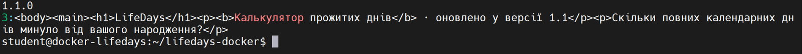

*Рис. 22 – Зміни для версії 1.1.0*

Новий образ зібрано з тегом lifedays:1.1 командою docker build

```bash
sudo docker build -t lifedays:1.1 .
```

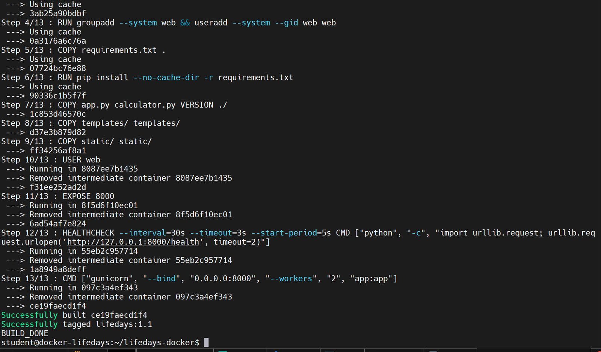

*Рис. 23 – Збирання образу lifedays:1.1*

Попередній контейнер видалено sudo docker rm -f lifedays, після чого з образу lifedays:1.1 запущено новий контейнер з тими самими параметрами. Команда docker ps показує контейнер у стані healthy, у списку присутні обидва образи 1.0 і 1.1

```bash
sudo docker rm -f lifedays
sudo docker run -d --name lifedays -p 192.168.56.101:8080:8000 lifedays:1.1
curl http://192.168.56.101:8080/health
```

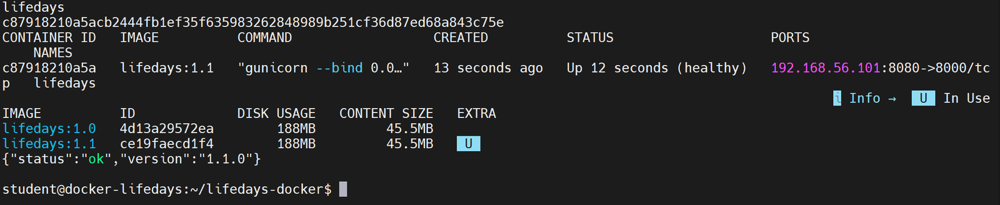

*Рис. 24 – Розгортання версії 1.1 і перевірка /health*

Після оновлення сторінки в браузері відображається новий рядок під заголовком

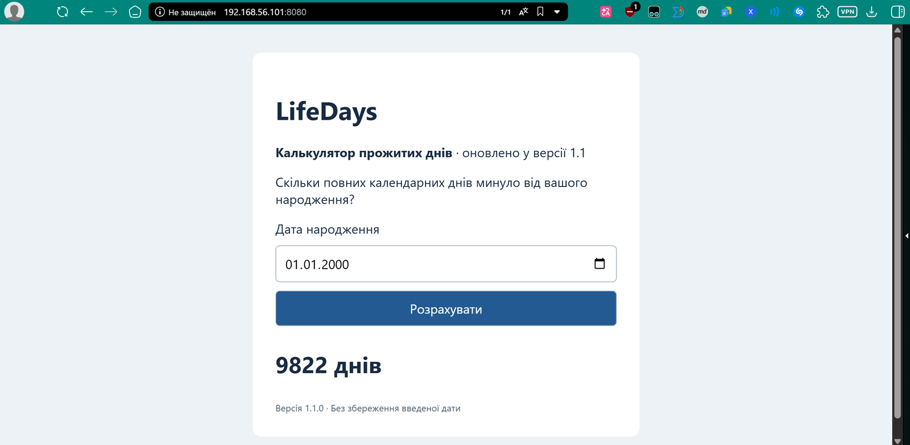

*Рис. 25 – Вебінтерфейс LifeDays версії 1.1.0*

## Відповіді на контрольні запитання

**1. Чим Docker-образ відрізняється від Docker-контейнера?**

Образ це незмінний шаблон, що складається з шарів файлової системи та метаданих. Контейнер це запущений екземпляр образу: Docker додає до шарів образу тонкий шар для запису та запускає ізольований процес. З одного образу можна створити багато контейнерів; у роботі з образу lifedays:1.0 створено контейнер lifedays.

**2. Яке призначення Dockerfile?**

Dockerfile це текстовий файл з інструкціями, який описує, як зібрати образ: базовий образ, встановлення залежностей, копіювання файлів застосунку, користувача, порт і команду запуску. Він робить збирання відтворюваним і дозволяє зберігати опис середовища виконання разом із програмним кодом.

**3. Чим відрізняються інструкції RUN та CMD?**

RUN виконується під час збирання образу і створює новий шар (користувача web і pip install). CMD під час збирання не виконується: вона задає команду за замовчуванням, яка запускається під час старту контейнера (gunicorn), і її можна перевизначити в docker run.

**4. Для чого використовується інструкція WORKDIR?**

WORKDIR задає робочий каталог для наступних інструкцій RUN, COPY, CMD і для процесу в контейнері; якщо каталогу немає, він створюється.

**5. Як здійснюється відображення мережевих портів?**

За допомогою параметра -p [IP:]host_port:conteiner_port команди docker run. Docker додає правила NAT, і з'єднання на 192.168.56.101:8080 віртуальної машини перенаправляються на порт 8000 контейнера в мережі bridge. Інструкція EXPOSE лише документує порт застосунку, а публікує його параметр -p; вказана IP-адреса обмежує прослуховування інтерфейсом Host-only.

**6. Чим відрізняються команди docker build та docker run?**

docker build створює образ із Dockerfile і контексту збирання. docker run створює з готового образу новий контейнер і запускає його з параметрами -d, --name, -p тощо. Збирання виконується один раз для кожної версії, а запуск для кожного нового контейнера.

**7. Чому застосунок доцільно запускати від непривілейованого користувача?**

Це принцип найменших привілеїв: якщо в застосунку буде знайдено вразливість, зловмисник отримає права обмеженого користувача, а не root усередині контейнера. Це ускладнює зміну файлів і спроби вийти за межі контейнера. У роботі процес працює від користувача web, а файли застосунку належать root і недоступні йому для запису.

**8. Яке призначення інструкції HEALTHCHECK?**

HEALTHCHECK задає команду, яку Docker періодично виконує всередині контейнера для перевірки працездатності застосунку. Виконується запит до /health з тайм-аутом 3 с. За результатом контейнер має стан starting, healthy або unhealthy. Це дозволяє відрізнити ситуацію, коли процес просто запущений, від ситуації, коли застосунок дійсно відповідає на запити.

**9. Чим відрізняються операції зупинення та видалення контейнера?**

docker stop надсилає процесу сигнал SIGTERM (а після тайм-ауту SIGKILL) і зупиняє контейнер, але контейнер зберігається разом із конфігурацією та шаром запису: його видно в docker ps -a і можна знову запустити командою docker start. docker rm видаляє контейнер повністю (rm -f – навіть запущений), при цьому образ, з якого його створено, залишається.

**10. Як здійснити повернення до попередньої версії застосунку?**

Оскільки образ попередньої версії має окремий тег і не видалявся, достатньо видалити поточний контейнер і запустити новий з попереднього образу: sudo docker rm -f lifedays, потім sudo docker run -d --name lifedays -p 192.168.56.101:8080:8000 lifedays:1.0. Саме тому кожну версію образу треба позначати власним тегом.

## Висновки

У ході виконання роботи підготовлено віртуальну машину з Ubuntu Server 24.04 LTS у VirtualBox з мережами NAT і Host-only, налаштовано статичну адресу 192.168.56.101 та підключення по SSH через MobaXterm. Встановлено Docker Engine.

Для вебзастосунку LifeDays на Flask і Gunicorn розглянуто Dockerfile, зібрано образ lifedays:1.0 і запущено контейнер з відображенням порту 8080 віртуальної машини на порт 8000 застосунку. Застосунок працює від непривілейованого користувача, проходить перевірку HEALTHCHECK і доступний з браузера. Відпрацьовано команди керування життєвим циклом контейнера (stop, start, restart, logs, stats, exec, inspect, rm) і виконано ручне оновлення до версії 1.1.0 зі збиранням нового образу та заміною контейнера. Наявність окремих тегів образів дозволяє за потреби швидко повернутися до попередньої версії.
